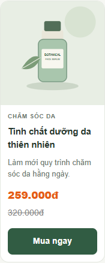
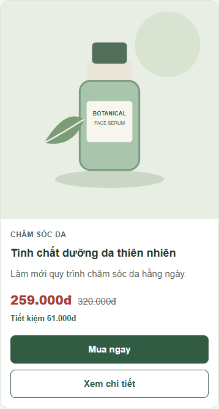

# Sống Xanh · Bài tập cá nhân Buổi 2

**Vũ Văn Hoàn · MSSV 31241028406**  
Phát triển ứng dụng thương mại điện tử · TS. Nguyễn Mạnh Tuấn · 04/11/2026

Tiếp tục mã nguồn Buổi 1, tập trung hoàn thiện danh sách bốn sản phẩm và thẻ sản phẩm. Website tham khảo: [Cỏ Mềm](https://comem.vn/). Sống Xanh, ảnh, quy cách và giá là dữ liệu minh họa trong bài học.

## Chạy giao diện

Mở `index.html` bằng Chrome/Edge, hoặc dùng Live Server trong VS Code. Giữ `css/`, `images/` và `san-pham/` đúng vị trí; không cần cài thư viện hoặc kết nối mạng để xem giao diện. Liên kết tham khảo Cỏ Mềm cần mạng khi được bấm.

## Các thay đổi chính

- Giữ **Mua ngay** làm nút CTA chính như Buổi 1, có hover/focus. Nút đang minh họa giao diện, chưa kết nối giỏ hàng hoặc đặt hàng.
- **Xem chi tiết** và ảnh sản phẩm mở đúng trang HTML tĩnh tương ứng trong `san-pham/`, có ảnh lớn, giá, mô tả, quy cách và liên kết quay lại. “Mở ảnh gốc” dẫn tới SVG cục bộ.
- Danh sách không còn khối sổ xuống, nên việc xem chi tiết không kéo giãn hàng Grid hoặc tạo khoảng trắng ở thẻ bên cạnh.
- Ngữ nghĩa HTML5: header/nav/main/section/article/footer, ul/li, h1/h2, dl/dt/dd, img có alt; CSS ngoài dùng đường dẫn tương đối.
- Box Model, element/class/descendant selector; Flexbox cho giá và nhóm thao tác; Grid 4/2/1 cột theo màn hình.
- Giữ padding điện thoại **16px** sau bước sinh viên tự sửa, padding máy tính 20px; tăng độ rõ chữ nhóm và màu giá cũ.
- Ảnh SVG kế thừa nguyên vẹn; không JavaScript, Bootstrap, Tailwind, backend hoặc thanh toán.

## Minh chứng và kiểm thử

**97/97 kiểm tra đạt**, 0 thất bại. Chrome `156.0.8078.76`; Edge `156.0.4314.58` kiểm tra bổ sung. Danh sách kiểm tra ở chín chiều rộng; bốn trang chi tiết có 16 trường hợp bố cục tại 1366/768/390/320px.

| Viewport px | Cột danh sách | Chiều rộng tài liệu px | Padding nội dung thẻ |
|---:|---:|---:|---|
| 320 | 1 | 320 | 16px |
| 360 | 1 | 360 | 16px |
| 390 | 1 | 390 | 16px |
| 599 | 1 | 599 | 16px |
| 600 | 2 | 600 | 20px |
| 768 | 2 | 768 | 20px |
| 1023 | 2 | 1023 | 20px |
| 1024 | 4 | 1024 | 20px |
| 1366 | 4 | 1366 | 20px |

Thẻ đóng tại 1366px cao 619,66px; khoảng cách mô tả–giá 16px. Đi tới trang chi tiết rồi quay lại không đổi chiều cao/vị trí giá. Bản sổ xuống trước đây có khoảng cách 226,78px ở ba thẻ bên cạnh khi mở thẻ đầu.

[Giao diện máy tính](minh-chung/sau/toan-trang-1366.png) · [Điện thoại](minh-chung/sau/toan-trang-390.png) · [Trang chi tiết](minh-chung/sau/chi-tiet-1366.png)

| Buổi 1 tại 390px | Bản hoàn thiện tại 390px |
|---|---|
|  |  |

## Hồ sơ thực hành

- [AI_USAGE theo chín prompt của đề](AI_USAGE.md)
- [Rà soát Buổi 1](tai-lieu/RA_SOAT_BUOI_1.md)
- [Báo cáo kiểm thử](tai-lieu/KIEM_THU.md) và [dữ liệu kiểm tra](minh-chung/ket-qua-kiem-thu.json)
- [Bảy câu hỏi kiến thức](tai-lieu/CAU_HOI_KIEN_THUC.md)
- [Thực hành cá nhân và sửa mã trực tiếp](tai-lieu/THUC_HANH_CA_NHAN.md)
- [Đối chiếu đề](tai-lieu/DOI_CHIEU_YEU_CAU.md)
- [GitHub](tai-lieu/GITHUB.md) và [nguồn tham khảo](tai-lieu/TAI_LIEU_THAM_KHAO.md)

Ảnh trong `sau/` là giao diện cuối; `dieu-chinh-giao-dien/` phân tích lỗi sổ xuống và cách sửa; `tu-thuc-hanh/` giữ minh chứng lịch sử bước padding 14→16px; `thu-nghiem/` chứa thay đổi CSS tạm để quan sát Flexbox/Grid.

## Repository và giới hạn

[Hoan1604/PTUD-ecommerce-ui-improvement](https://github.com/Hoan1604/PTUD-ecommerce-ui-improvement), nhánh `main`, tiếp tục lịch sử Buổi 1. Không khẳng định đã triển khai GitHub Pages.

Kiểm tra tự động do Codex thực hiện trên Windows/Chromium; chưa thử Safari/Firefox, điện thoại vật lý hoặc trình đọc màn hình. Bài tập Buổi 2 tập trung HTML/CSS; tìm kiếm, lọc và xử lý giỏ hàng thuộc bước phát triển JavaScript sau.

## Công cụ kiểm tra tùy chọn

Trang web không phụ thuộc Node.js. Nếu muốn chạy lại kiểm tra, cài Node.js và Chrome, chạy `npm install` rồi `npm test`. Công cụ dùng `tools/kiem-tra.cjs`; có thể đặt `PTUD_BROWSER` và `PTUD_EDGE` để chọn trình duyệt. Không cần cài những công cụ này chỉ để xem hoặc chấm giao diện.
